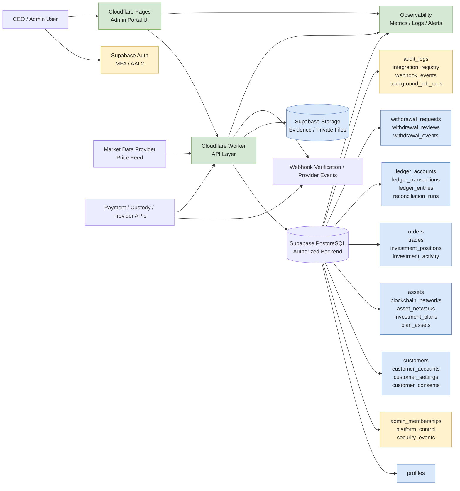

# Cryptocurrency Platform Architecture Overview

This document describes the planned architecture for the CEO admin backend foundation and the staged rollout for the customer portal.



## Core principles

- CEO access is explicitly authorized and enforced server-side.
- `financial_operations_enabled` remains `false` during the development phase.
- Real deposits, withdrawals, payouts, and live trading remain disabled until verified.
- All business logic should validate inputs on the server and enforce database safeguards.
- Customer-facing actions should never be able to self-grant admin privileges.
- Ledger posting remains immutable; corrections use documented reverse entries.

## Functional domains

### 1. Platform security and admin authorization
- `profiles`
- `platform_control`
- `admin_memberships`
- `security_events`
- `audit_logs`

### 2. Customer and account data
- `customers`
- `customer_accounts`
- `customer_settings`
- `customer_consents`

### 3. Assets, prices, and plans
- `assets`
- `blockchain_networks`
- `asset_networks`
- `investment_plans`
- `plan_assets`
- `market_prices`

### 4. Deposits and payment verification
- `deposit_requests`
- `deposit_evidence`
- `deposit_events`
- `payment_provider_events`

### 5. Investment simulations and orders
- `investment_accounts`
- `investment_positions`
- `orders`
- `order_events`
- `trades`
- `investment_activity`

### 6. Ledger and accounting
- `ledger_accounts`
- `ledger_transactions`
- `ledger_entries`
- `balance_snapshots`
- `reconciliation_runs`
- `reconciliation_items`

### 7. Withdrawals and payouts
- `withdrawal_requests`
- `withdrawal_reviews`
- `withdrawal_events`
- `payout_provider_events`

### 8. Reporting and operational monitoring
- `performance_snapshots`
- `realized_pnl_records`
- `unrealized_pnl_snapshots`
- `fee_records`
- `accounting_adjustments`
- `integration_registry`
- `webhook_events`
- `background_job_runs`

## Notes for implementation

- Use Supabase Auth for authenticated identity.
- Enforce Row Level Security on all application-accessible tables.
- Use database functions and server-side workflows for privileged operations.
- Prefer additive migrations and explicit status transitions.
- Keep all provider credentials and secret material outside the repository and client bundle.
- Treat external market data as untrusted and keep all live financial actions disabled until validated.

## Status

This file is a production-oriented architecture starter for the admin portal implementation. The actual database and backend migration work should be implemented in the repository once the project codebase and Supabase environment are available and verified.

```text
Status: Architecture specification only
Environment: Not yet connected to a verified live project
Financial operations: Disabled by design
```


